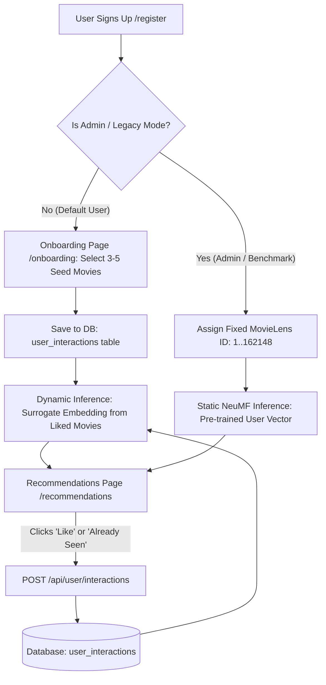
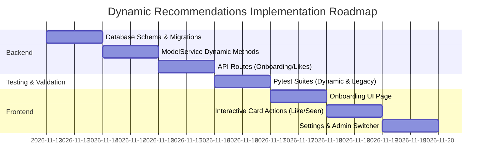

# Implementation Plan: Dynamic Onboarding & User Interaction Engine

> **Document Version:** 1.0.0  
> **Target System:** Neural Collaborative Filtering Movie Recommender  
> **Objective:** Transition from static pre-assigned MovieLens profiles to an interactive, dynamic recommendation engine driven by live user selections and taste evolution, while preserving the legacy cold-start mode for administration, benchmarking, and backward compatibility.

---

## 1. Architectural Vision & Core Principles



### Guiding Principles:
1. **Zero Retraining Required:** All item embeddings ($\mathbf{e}_m \in \mathbb{R}^{32}$ for GMF and $\mathbb{R}^{32}$ for MLP) are pre-trained for 47,396 movies. Live user embeddings are formed dynamically via surrogate item vector aggregation.
2. **Backward Compatibility:** Existing endpoints (`GET /api/recommend` and `POST /api/predict`) continue to work seamlessly. If a user has dynamic likes, the system serves dynamic recommendations; if an admin account has a pre-mapped MovieLens ID and no manual likes, it falls back to the legacy mode.
3. **Real-Time Adaptation:** Every time a user likes a movie or marks it as "Already Seen", their recommendation pool updates, and seen movies are instantly filtered out.

---

## 2. Database Schema Additions

### 2.1. Update `User` Table (`backend/app/services/db.py`)
Modify the existing `User` model to support optional MovieLens ID linkage and user roles:

```python
class User(Base):
    __tablename__ = "users"

    id = Column(Integer, primary_key=True, index=True)
    email = Column(String(255), unique=True, index=True, nullable=False)
    password_hash = Column(String(255), nullable=False)
    # Nullable for standard users who build taste dynamically;
    # populated for Admin or legacy benchmark accounts:
    movie_lens_user_id = Column(Integer, unique=True, index=True, nullable=True)
    role = Column(String(50), default="user", nullable=False)  # "user" | "admin"
    onboarding_completed = Column(Boolean, default=False, nullable=False)
    created_at = Column(DateTime(timezone=True), server_default=func.now())
```

### 2.2. New `UserInteraction` Table (`backend/app/services/db.py`)
Track user actions on movies:

```python
class UserInteraction(Base):
    __tablename__ = "user_interactions"

    id = Column(Integer, primary_key=True, index=True)
    user_id = Column(Integer, ForeignKey("users.id", ondelete="CASCADE"), index=True, nullable=False)
    movie_id = Column(Integer, index=True, nullable=False)  # Raw MovieLens movieId
    interaction_type = Column(String(50), nullable=False)   # "liked" | "seen" | "disliked"
    created_at = Column(DateTime(timezone=True), server_default=func.now())
```

---

## 3. Machine Learning & Inference Service (`backend/app/services/model_service.py`)

### 3.1. Mathematical Formulation for Dynamic Vectors
When a user has a set of liked movies $M_{\text{liked}} = \{m_1, m_2, \dots, m_k\}$:

$$\mathbf{e}_{\text{user}}^{\text{GMF}} = \frac{1}{|M_{\text{liked}}|} \sum_{m \in M_{\text{liked}}} \mathbf{e}_{m}^{\text{GMF}}, \quad \mathbf{e}_{m}^{\text{GMF}} \in \mathbb{R}^{32}$$
$$\mathbf{e}_{\text{user}}^{\text{MLP}} = \frac{1}{|M_{\text{liked}}|} \sum_{m \in M_{\text{liked}}} \mathbf{e}_{m}^{\text{MLP}}, \quad \mathbf{e}_{m}^{\text{MLP}} \in \mathbb{R}^{32}$$

### 3.2. New Additive Service Methods
Without modifying existing `recommend_top_n()` or `predict_preference()`, add:

1. `recommend_from_liked_movies(liked_movie_ids: List[int], excluded_movie_ids: Set[int], top_n: int = 10)`:
   - Computes surrogate user vector from `liked_movie_ids`.
   - Filters candidate movies to exclude all items in `excluded_movie_ids` (both liked and seen).
   - Evaluates NeuMF across candidates and returns ranked Top-$N$ list.
2. `predict_from_liked_movies(liked_movie_ids: List[int], target_movie_id: int) -> float`:
   - Evaluates NeuMF preference probability on `target_movie_id` using the user's surrogate vector.

---

## 4. API Endpoints Specification

### 4.1. Onboarding & Interaction Routes (`backend/app/api/interaction_routes.py`)

| Method | Endpoint | Auth | Description |
| :--- | :--- | :---: | :--- |
| `POST` | `/api/user/onboarding` | Required | Submit 3–5 initial movie IDs to finish onboarding and mark `onboarding_completed = True`. |
| `POST` | `/api/user/interactions` | Required | Record an interaction (`{ "movie_id": 1, "interaction_type": "liked" \| "seen" }`). |
| `DELETE` | `/api/user/interactions/{movie_id}` | Required | Undo a like or seen tag. |
| `GET` | `/api/user/interactions` | Required | Retrieve list of all movies liked or marked seen by current user. |

### 4.2. Unified Recommendation & Prediction Routing
Update [`backend/app/api/routes.py`](file:///c:/Users/ACER/OneDrive/Desktop/movie%20Remommender using NCF/backend/app/api/routes.py):
* `GET /api/recommend`:
  * **Branch 1 (Dynamic User):** If user has records in `user_interactions`, call `recommend_from_liked_movies()`, automatically excluding all liked and seen movies.
  * **Branch 2 (Cold-Start / Admin Profile):** If user has no interactions but has `movie_lens_user_id`, run the legacy fixed-vector inference.
  * **Branch 3 (Unconfigured):** If user has neither, return a prompt with `status: "needs_onboarding"`.
* `POST /api/predict`:
  * Evaluates affinity using dynamic surrogate vector if interactions exist, or pre-mapped vector if cold-start.

### 4.3. Admin Cold-Start Account Provisioning (`POST /auth/admin/create-coldstart`)
* Dedicated endpoint restricted to `role == "admin"`.
* Allows creating or switching an account to map to any specific MovieLens benchmark ID (e.g., ID 1..162148) for model evaluation and latency testing.

---

## 5. Frontend UI/UX Workflow & Components

### 5.1. Onboarding Page (`frontend/src/pages/OnboardingPage.jsx`)
* **Trigger:** Redirected here immediately after registering if `onboarding_completed == false`.
* **Interface:**
  * Clean, Netflix-style visual selector featuring ~24 diverse popular titles across major genres.
  * Search bar allowing the user to search for any specific movie if their favorites aren't on the curated list.
  * Floating progress pill: *"Select at least 3 movies to calibrate your taste (X/3 selected)"*.
  * "Generate My Recommendations" button activates once $\ge 3$ movies are selected.

### 5.2. Recommendations Page Additions (`frontend/src/pages/RecommendationsPage.jsx`)
* Each movie card gets interactive status badges:
  * ❤️ **Like** (adds to positive embedding pool).
  * 👁️ **Already Seen** (filters the movie out of future recommendations without skewing preferences).
  * ✖️ **Dismiss / Not Interested**.
* An alert pill at the top: *"Recommendations tailored to your 4 liked movies. Liked a new movie? Your recommendations refresh automatically."*

### 5.3. Predictor Page (`frontend/src/pages/PredictorPage.jsx`)
* When an authenticated user selects a movie to predict, the page displays:
  * "Affinity computed based on your current taste profile: *[List of your recent liked films]*".
  * Allows user to temporarily add/remove test films to see how the predicted score changes in real time.

### 5.4. Settings Page Additions (`frontend/src/pages/SettingsPage.jsx`)
* **Taste Profile Tab:**
  * Displays user's list of liked movies with the ability to remove items.
  * Reset Taste button (allows restarting the onboarding questionnaire).
* **Admin Tools (Visible only if `user.role === 'admin'`):**
  * Toggle between "Dynamic Taste Mode" and "Fixed MovieLens ID Mode".
  * Selector to simulate any MovieLens user ID from the 162k catalog.

---

## 6. Phased Implementation Roadmap



### Phase 1: Database & Core Service Additions
1. Update `backend/app/services/db.py` to add `UserInteraction` and update `User` fields.
2. In `backend/app/services/model_service.py`, implement `recommend_from_liked_movies` and `predict_from_liked_movies`.
3. Add tests in `tests/test_dynamic_recommender.py` verifying vector math and exclusions.

### Phase 2: REST Endpoints & Route Routing
1. Implement `backend/app/api/interaction_routes.py` (`/api/user/onboarding`, `/api/user/interactions`).
2. Update `GET /api/recommend` and `POST /api/predict` to support dynamic fallback.
3. Verify with Pytest that all existing 56 tests still pass alongside new interaction tests.

### Phase 3: Frontend Onboarding & Live Card Actions
1. Build `OnboardingPage.jsx` with curated popular grid and selection counter.
2. Update `MovieCard.jsx` and `MovieDetailsModal.jsx` to include "Like" and "Already Seen" buttons.
3. Update `RecommendationsPage.jsx` to reflect dynamic profile state.

### Phase 4: Admin Controls & Verification
1. Add role checks and cold-start simulation tools in `SettingsPage.jsx`.
2. Run end-to-end tests verifying that both new dynamic accounts and legacy cold-start accounts behave properly.

---

## 7. Safety, Testability & Non-Breaking Verification

To guarantee that no existing features are broken during this enhancement:
1. **Isolated Table:** The new `user_interactions` table is decoupled from authentication tables; existing login and JWT logic remain unaffected.
2. **Automated Regression Suite:** The existing `run_tests.py` suite (all 56 unit/integration tests) will be executed at each phase.
3. **Graceful Fallbacks:** If a user has no interactions, the API gracefully checks for a legacy `movie_lens_user_id` or prompts for onboarding rather than crashing with 404 or 500 errors.

