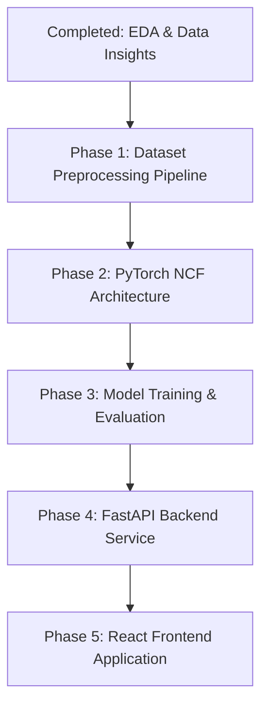

# Next Steps After EDA: Post-EDA Implementation Roadmap

This document outlines the systematic, step-by-step roadmap for building the complete **Neural Collaborative Filtering (NCF / NeuMF)** Movie Recommender System, moving from EDA to model training, backend API deployment, and frontend integration.

---



---

## Phase 1: Dataset Preprocessing & Data Pipeline (`ML/preprocess.py`)

### 1.1 Data Filtering & Implicit Feedback Conversion
* Load `ratings.csv` and filter out users with $< 5$ ratings to prevent extreme cold-start noise.
* Convert explicit ratings into implicit binary labels:
  $$y_{u,i} = \begin{cases} 1 & \text{if rating } \ge 3.5 \\ \text{Omitted} & \text{if rating } < 3.5 \end{cases}$$

### 1.2 Remapping User and Movie IDs
* Map original `userId` and `movieId` to contiguous zero-indexed integers:
  $$\text{User Map: } \{ \text{raw\_userId} \to [0, N_u - 1] \}$$
  $$\text{Movie Map: } \{ \text{raw\_movieId} \to [0, N_i - 1] \}$$
* Export `user2id.json`, `id2user.json`, `movie2id.json`, and `id2movie.json` artifacts for inference lookup.

### 1.3 Temporal Leave-One-Out Train/Val/Test Split
For each user (sorted chronologically by timestamp):
* **Test Set:** The latest positive interaction $(u, i_{\text{test}})$ + 99 randomly sampled negative items.
* **Validation Set:** The second-to-last positive interaction $(u, i_{\text{val}})$ + 99 randomly sampled negative items.
* **Train Set:** All remaining historical interactions.

### 1.4 Dynamic Negative Sampling PyTorch Dataset
* Implement `NCFDataset(torch.utils.data.Dataset)` with an `on_epoch_end()` negative sampler to dynamically generate 4 negative samples per positive pair every training epoch.

---

## Phase 2: PyTorch NCF Model Architecture (`ML/model.py`)

Implement the **Neural Matrix Factorization (NeuMF)** architecture combining **GMF** and **MLP**:

```
                  Output Layer (Sigmoid Probability)
                                 ▲
                                 │
                   NeuMF Layer (Concatenation)
                    ┌────────────┴────────────┐
                    │                         │
               GMF Vector                MLP Vector
                    │                         ▲
           Element-wise Prod             Dense Layers
             (P_u ⊙ Q_i)              (64 -> 32 -> 16)
             ┌──────┴──────┐                  ▲
             │             │            Concatenation
        User Embed    Item Embed       ┌──────┴──────┐
         (GMF P_u)     (GMF Q_i)   User Embed    Item Embed
                                    (MLP P_u)     (MLP Q_i)
```

### Architecture Specifications:
* **GMF Branch:** Latent factor dimension $K_{gmf} = 32$. Element-wise product $\mathbf{\phi}^{GMF} = \mathbf{P}_u^G \odot \mathbf{Q}_i^G$.
* **MLP Branch:** Embedding dimension $K_{mlp} = 32$. Dense layers: $64 \to 32 \to 16 \to 8$ with `ReLU` activations and `Dropout(p=0.2)`.
* **NeuMF Output:** $\phi^{NeuMF} = [\mathbf{\phi}^{GMF}, \mathbf{\phi}^{MLP}]$, passed to a linear layer with Sigmoid activation outputting prediction score $\hat{y}_{u,i} \in [0, 1]$.

---

## Phase 3: Model Training & Metric Evaluation (`ML/train.py`)

### 3.1 Training Parameters
* **Loss Function:** `BCEWithLogitsLoss()` (Binary Cross Entropy with Logits for numerical stability).
* **Optimizer:** `AdamW(lr=0.001, weight_decay=1e-5)`.
* **Batch Size:** 256 or 512.
* **Epochs:** 15–20 with Early Stopping based on Validation NDCG@10.

### 3.2 Evaluation Metrics
* **Hit Ratio @ K (HR@K):** Evaluates whether the ground-truth test movie is present in the top-K recommended list.
* **NDCG @ K (NDCG@K):** Evaluates the position of the test movie, penalizing recommendations where the target item appears lower in the list.

### 3.3 Artifact Generation
Save trained weights and mappings to `backend/model_artifacts/`:
* `neumf_best_model.pth`
* `user_mappings.json`
* `movie_mappings.json`
* `movie_metadata.parquet` (processed movie titles, genres, and TMDB links)

---

## Phase 4: Backend API Development (`backend/app/`)

Build a high-performance **FastAPI** REST API serving recommendations in real-time.

### Key Endpoints:
1. `GET /health` – API status check.
2. `GET /api/v1/movies` – Paginated list of movies with search and genre filter.
3. `GET /api/v1/recommend?user_id={id}&top_k=10` – Returns top K personalized movie recommendations for a user.
4. `POST /api/v1/predict` – Accepts a user ID and candidate movie list, returning predicted preference scores.
5. `GET /api/v1/users` – Returns a sample list of active user IDs for interactive UI demo testing.

---

## Phase 5: React Frontend Application (`Frontend/`)

Build an aesthetic, responsive web frontend using **React + Vite** with modern UI principles.

### Key Components & Views:
* **Dashboard Header:** Search bar, genre filter, active user switching modal.
* **User Profile & Rating History:** View past rated movies for the selected user.
* **Personalized Recommendation Carousel:** Display top-K recommended movies generated by NCF with poster images, genres, and predicted match scores (%).
* **Interactive Movie Details Modal:** View movie synopsis, trailer links, and submit quick ratings.
